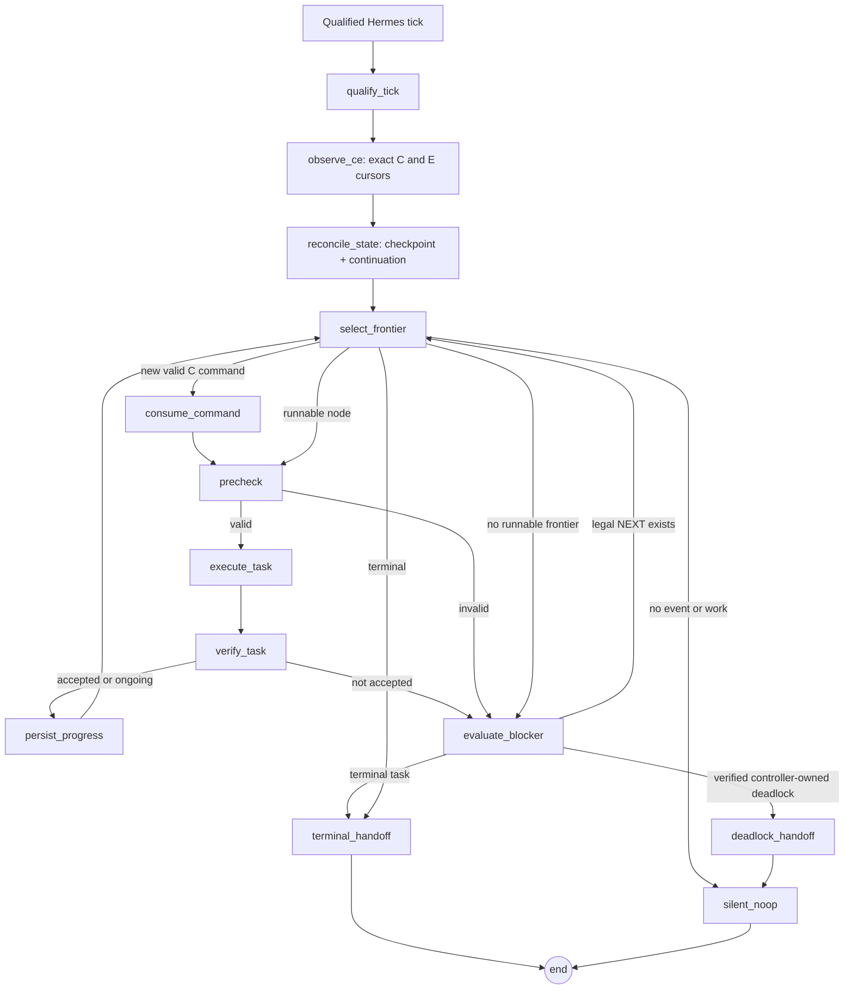
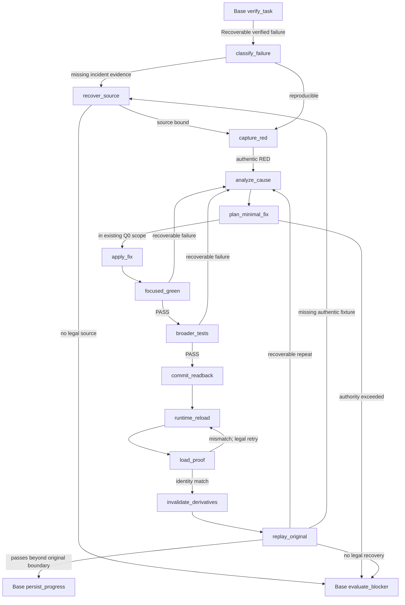

# Hermes Loop × A2A — Node Architect Base Workflow R1

**Status:** design proposal / NOT runtime qualified. **Scope:** SCRUM-781 Q0 integration POC, GWC Universal v2. **Definition:** [machine-readable base graph](../node-architect/hermes-loop-a2a-base-workflow-r1.json). **Source of operational semantics:** DW-SuperApps `docs/runbooks/HERMES_DESKTOP_RUNTIME.md`, `docs/runbooks/TASKCONTROLLER_MAILBOX_V2.md`, `agents/hermes/agent-instructions.md` (the changes in DW Draft PR #162 are **not yet main**). This design translates those requirements; it does not duplicate or replace their host authority.

## Architectural decision

**One Workflow Run = a collection of Node Architect nodes.** The graph is compiled from a **source-bound** RuntimePlan, not created ad hoc by Hermes/LLM. The same Run's plan identity, node DAG, legal atomic frontier, acceptance/evidence predicates and GWC Universal `UR.G0..UR.G6` authority remain in GWC. LangGraph is an **optional execution backend** of GWC Node Architect, not a new lifecycle or authority source. DW/Hermes owns timer/session delivery and adapter. This base workflow must work **before** any self-repair node or RED→FIX→GREEN extension.

**Important Q0 limitation:** original plan `core/node-architect/scrum781-q0-fresh-execution-plan-r2.json` remains `UR.G2`, `max_children=0`, `max_parallel=1`. The 14 execution nodes in this base template **do not create Child Runs**. Do not modify a sealed RuntimePlan in place; materialization must produce a new authorized plan/profile revision bound to exact source and digest. Until then this is a **proposal**, not a runnable authorized Q0 campaign.

## Workflow composition and ownership

| Layer | Owns | Not allowed |
| --- | --- | --- |
| Node Architect (GWC) | Node catalog, template, typed edges, dependency DAG, compiler, immutable RuntimePlan | Invent new authority from a graph |
| Universal v2 (GWC) | Native gate cursor, receipts, effect guards, acceptance | Advance a gate from graph checkpoint |
| LangGraph backend (GWC) | Compile typed nodes to StateGraph, route, checkpoint, resume | Treat checkpoint as canonical machine event |
| Hermes Loop (host) | Qualified bounded tick and session/work-cycle scheduling | Assume Loop tick == task done, create LLM wake on raw cursor |
| Hermes Executor (host) | Execute one bounded authorized work step; exact evidence | Duplicate external effect on retry |
| DW A2A adapter | Read C/E, continuation; authenticated pointer-only wake | Guess provider availability, mint C/E events |
| GPT Controller | Terminal decision or verified deadlock unlock | Receive progress wake on every tick |

## Base execution paths

`end` completes **the bounded graph invocation/tick**, not necessarily the Q0 Workflow Run. Persisted task state and the next frontier determine future invocations. Explicit RUN_HOLD / user pause is binding. An authorized mission may run even when there is no mailbox event.

## Required runtime interfaces

1. `compile_workflow(runtimeplan_ref, exact_plan_digest, engine='langgraph') -> CompiledWorkflow`: check catalog node names, DAG dependencies, atomic frontier, guards, no unapproved effect, same Q0 plan revision, pinned instruction bundle.
2. `observe_ce(run_id, agent_instance, loop_binding, observed_high_water) -> ObservedCursors`: bounded exact C **and** E read; changed cursor triggers source-bound typed event + durable continuation verification. Does not consume.
3. `select_frontier(validated_runtimeplan, task_receipts) -> RunnableTask | Noop | BlockerCandidate | TerminalCandidate`: deterministic; must distinguish task-level and Universal-gate completion.
4. `execute_one(task, authority_ref, idempotency_key) -> ExecutionAttempt`: host adapter; no direct graph-owned GitHub write or approval.
5. `verify_and_persist(attempt) -> ReceiptRefs`: satisfy task acceptance, exact effect readback, durable native evidence, checkpoint.
6. `controller_handoff(kind, source_bound_receipt, correlation_key) -> DeliveryReceipt`: only `TASK_TERMINAL` or `VERIFIED_DEADLOCK_UNLOCK`; durable outbox + verified adapter, with dedup on restart.
7. `resume_after_unlock(source_bound_controller_event, same_run_thread_id)`: verify actor, scope and authority; unblocks same task; no new Run.

**Thread key:** canonical run + materialized workflow instance ID. **Graph state** stores observed and consumed cursors separately. **Canonical authority:** C/E mailbox, continuation and GWC native receipts. Local checkpoint is only replay/recovery projection.

## Strict deadlock criterion

No-progress means a qualified **engineering work cycle** actually tried one lawful action/recovery, verified no new evidence/progress and found no independently runnable frontier. **Only then**, if the remaining blocker is Controller-owned and no identical request is pending, persist `DEADLOCK_ESCALATION` with blocker owner, attempted remedies, 2–3 alternatives, release trigger and exact identity; wake GPT once via the admitted adapter. Do not count timer ticks or unchanged cursor, and do not escalate routine RED/verification failures. If GPT is BUSY, retain one pending correlation. Unlock must resume **same task**.

**Deliver-once caveat:** exactly-once *external delivery* cannot be guaranteed merely by LangGraph checkpoint. The outbox uses an idempotency key and receipt reconciliation; duplicate delivery must not cause duplicate execution/acceptance. Checkpoint before external effect is insufficient proof of effect success.

## Delivery order: base before self-repair

- **BASE-1 (GWC):** validate the machine-readable workflow template, existing RuntimePlan identity, graph nodes/routes/guards, and produce a pinned compiler contract.
- **BASE-2 (GWC):** implement minimal LangGraph StateGraph backend with test-only deterministic worker; prove task dependency execution and receipt persistence. Do not make LangGraph mandatory for other GWC workflows.
- **BASE-3 (DW/Hermes):** implement/qualify Loop tick → C/E observer → graph invoke + durable checkpoint, using authenticated host/session binding. Do not infer live adapter from runbook.
- **BASE-4 (DW+GWC):** test terminal handoff, one deadlock unlock, duplicate tick, crash/restart and same-task resume with real bound A2A source. No self-repair implementation.
- **ONLY AFTER BASE 9/9 AC PASS:** add a separate `SELF_REPAIR` extension subgraph with `analyze → bounded_fix → verify → reload → replay`, independently governed by Q0 authority. Synthetic smoke RED/GREEN cannot count as original DWO replay.

## Acceptance matrix (base)

| ID | Required proof |
|---|---|
| B1 | Source-bound RuntimePlan → valid graph, invalid digest/edge/effect rejected |
| B2 | Qualified tick reads C/E exact, unchanged cursor + no task → zero LLM turn |
| B3 | New valid Controller command consumed with correct continuation |
| B4 | Two dependent tasks execute in order and emit receipts, zero intermediate GPT wakes |
| B5 | Overlap/restart doesn't duplicate writer or external effects |
| B6 | Verified deadlock after actual bounded recovery → one durable escalation/wake |
| B7 | Controller unlock resumes same run/thread/task, no reset |
| B8 | Task terminal → one terminal wake; not native UR.G6 certification |
| B9 | Wrong run/actor/digest or real pause/RUN_HOLD fails closed |

**POC ACCEPT:** all B1–B9 pass including host/provider evidence. A local LangGraph in-memory test alone is only ENGINE_SMOKE. An unloaded adapter or unconsumed GitHub comment is NOT E2E.

## Non-goals in base

No RED→FIX→GREEN implementation; no general multi-agent fanout; no GWC Child Run creation; no protected merge/deploy/production; no unauthorized Q0 plan mutation; no starting original DWO Login feature. Continue Q0 P1 original-failure recovery separately. Link to this source from Q0 runbook; do not drive runtime from #595 comments.

## Self-repair extension review — gated behind base execution proof

**Authoritative machine-readable proposal:** [Hermes Loop Self-Repair Workflow R1](../node-architect/hermes-loop-self-repair-workflow-r1.json). This is a child **execution subgraph**, not a new GWC Child Run; Q0 `max_children=0` and one-writer constraints remain in force. Integrates at Base Graph `verify_task` on `genuine_recoverable_failure`; exits only to `persist_progress` after original replay progresses beyond failure, or to `evaluate_blocker` when no legal local next action remains. Merely ending a graph invocation or reaching a green unit test does not mean a task or Q0 completed.

**Mandatory repair invariant**: authentic original-failure RED (fixture provenance, source SHA, test invocation/signature) → scoped fix in the existing one-writer worktree → focused GREEN + broader regression → additive commit/push with exact remote readback → runtime process/session reload and loaded profile/module/instruction identity → invalidate/regenerate dependent derivative state → replay authentic original fixture with exact readback past old failure boundary. Repair is `FIX_IMPLEMENTED` on GREEN at most; do not report `RUNTIME_FIXED` until full sequence. Synthetic fault injection qualifies *adapter mechanics only*, never SCRUM-781 original-incident certification.

**Early-unlock policy:** A budgeted tick ending, stale cursor, or initial RED is not deadlock. The base `evaluate_blocker` only requests Controller unlock after a genuine bounded recovery work cycle establishes no runnable legal alternative and a Controller-owned decision is needed; dedupe by canonical run/task/consumed seq/blocker fingerprint. Continue other lawful actions where available, but respect genuine `RUN_HOLD`. Controller returns source-bound NEXT/authority and the Executor resumes the same run/task/checkpoint. The external wake adapter must have an observed delivery receipt; a posted comment is not delivery.

**Release gates:** (i) Base B1–B9 live host E2E PASS, then (ii) Self-repair SR1–SR12 with authentic fixture and exact load/replay PASS, then (iii) Q0 full campaign verification and independent G6 acceptance. Document/JSON static checks alone do not pass either live gate. LangGraph is optional backend; no fallback to GWC legacy runtime, no protected-main merge/deploy authority added here.
